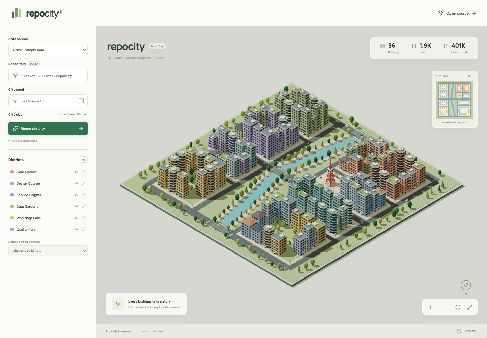

# RepoCity

Explore software repositories as interactive, low-poly miniature cities. Enter a **GitHub URL or `owner/repository`**, load the repository, and explore its buildings. Each supported source file becomes one building; folders form districts. Public repositories are analyzed directly in the browser. The RepoCity example project is available immediately, alongside an optional fictional demo.

React · TypeScript · Vite · Three.js · React Three Fiber



## Getting started

Requires **Node.js 22.12+** and npm.

```sh
npm ci
npm run dev
```

Open **http://127.0.0.1:5174**. The fixed port prevents browser tests from accidentally connecting to another project. To use another port: `npm run dev -- --port 5180`.

```sh
npm run build        # Type checking and production build in dist/
npm run preview      # Preview the production build
npm run analyze      # Analyze the current repository as a JSON snapshot
npm test             # Analyzer, GitHub adapter, layout, geometry, and camera tests
npx playwright install chromium
npm run test:e2e      # Browser tests with actual WebGL
REPOCITY_E2E_PREVIEW=1 npm run test:e2e # Test the production build
npm run format:check
```

The interface, accessibility labels, progress messages, errors, and generated file descriptions use English. Number formatting uses the `en-US` locale.

## Publishing

Run `npm run build` and deploy the contents of `dist/` to a static hosting service, including under a subpath. Hosting requires no Node.js process, backend service, API key, or local checkout. GitHub imports run in the visitor's browser.

1. Enter a repository's GitHub URL or `owner/repository`.
2. Click **Load repository**.
3. Select a building to explore its source file at the imported commit.

## GitHub imports

- **Public repositories:** No login or token is required. Private repositories and GitHub Enterprise instances are not supported. Enter the repository homepage; file and branch URLs are rejected.
- **Consistent revision:** The default branch is resolved to one commit. The file tree, file sizes, measurements, and source links use that commit. The heading displays its branch and short commit ID.
- **Complete representation:** Every supported source file in the returned tree receives a building. There is no sampling, 768-file limit, or 32 MiB repository limit. Shared filters exclude dependencies, generated files, hidden paths, and unsupported file types.
- **Loading and cancellation:** Imports fetch repository metadata and the file tree. Progress and cancellation are visible. Errors, cancellation, and input edits preserve the last successful city. Imports time out after two minutes.
- **File measurements:** Selecting a building downloads only that file from `raw.githubusercontent.com` and counts non-empty lines, including comments. Code is never executed. Measurements are bound to the imported commit, cancelled on selection changes, and cached while the information panel remains open. Failed measurements can be retried. Files exceeding 8 MiB or containing binary data retain their buildings without a line measurement. Each measurement has a 30-second timeout.
- **Missing metrics:** Dependencies and test coverage remain **Not available**. They are not inferred from file structure.
- **API limits:** Each import uses three GitHub API requests. Selected source files are fetched separately. Rate limit errors are displayed. A truncated GitHub file tree is rejected rather than presented as complete. See [GitHub's REST API rate limit documentation](https://docs.github.com/en/rest/using-the-rest-api/rate-limits-for-the-rest-api).
- **Data exchange:** Submitting a GitHub import contacts `api.github.com`; opening a building also contacts `raw.githubusercontent.com`. RepoCity has no intermediary server and does not store tokens or repository data in browser storage.

## Exploring the city

- **Rotate:** Drag with the left mouse button, or use one finger on a touchscreen.
- **Pan:** Drag with the right mouse button, or use two fingers.
- **Zoom:** Use the scroll wheel, pinch gesture, or plus/minus buttons. The scroll wheel zooms towards the pointer. Large repositories support close-ups of individual buildings.
- **Reset view:** Use the reset button at the bottom right.
- **Select a module:** Click a building or the miniature map, or use the keyboard-accessible module selector. The camera centres the selected building and zooms close enough to see it, including in large repositories.
- **Highlight a district:** Click its name in the sidebar; click again to clear the highlight.
- **Choose data:** Load GitHub data, use the included RepoCity example, or select the fictional demo. The heading and building information identify the active source.
- **Generate another layout:** Enter a seed and click **Generate city**. In the demo, the repository name controls fictional metrics and the city size controls the building count. The dice button changes the seed input without submitting.

The initial city uses the included RepoCity snapshot and the `hello-world` seed. The form is ready for a GitHub import; network requests start only after submission. A snapshot and seed always reproduce the same streets, architecture, plants, and decoration. Changing the seed changes the layout without changing module identities or metrics.

Compact, rectangular blocks have buildings on four street frontages. Independently subdivided neighbourhoods, quays, staggered side streets, and a few wider boulevards form a connected street network with T-junctions and river bridges. The river meanders within a reserved greenway; it does not shear the buildings, streets, or city boundary. Its bends stay bounded as repositories grow. Larger files occupy central plots within their district, creating clusters of taller buildings while retaining one shared metric-to-height scale. Courtyard gardens, parks with ponds or play courts, a narrow scattered tree belt, varied roofs, and a civic square break up the built area. The miniature map uses the same roads and building positions.

The camera starts at an oblique isometric angle and keeps facades visible throughout its orbit. Its overview fits the city footprint and skyline, and its depth range grows with the city. Rotating a large repository therefore keeps its far side visible. Close-up zoom is independent of repository size and is available on desktop and mobile. Reset view returns to the complete overview.

## Local analysis and CLI

A Vite plugin analyzes the current project at development-server startup and during production builds. It includes a snapshot with relative paths and measured metrics; it neither embeds source contents nor executes project code. Restart the development server or rebuild to refresh this snapshot. Visitors do not need local analysis.

To include another project as the example:

```sh
REPOCITY_REPOSITORY=/absolute/path/to/project npm run dev
REPOCITY_REPOSITORY=/absolute/path/to/project npm run build
```

The standalone analyzer exports the same provider-neutral format:

```sh
npm run analyze -- . --output /tmp/repocity-snapshot.json
npm run analyze -- /path/to/project --name my-project --output /tmp/project-snapshot.json
```

- **Stable IDs:** Relative source paths identify buildings and remain stable across content changes.
- **Folder districts:** Under `src`, `app`, and `lib`, files are grouped by the next subdirectory, such as `src/city`. Other files use their top-level folder; project-level files belong to **Project root**.
- **Measured size:** Local `lines` counts non-empty lines, including comments. Building heights follow a fixed logarithmic scale of 2–18 floors, with 1.9 world units per floor. GitHub snapshots use file sizes in bytes on a separate, consistently applied logarithmic scale.
- **Supported files:** TypeScript, JavaScript, CSS/SCSS, HTML, Vue, Svelte, Python, Go, Rust, Java, Kotlin, Swift, Ruby, PHP, C/C++, C#, Shell, and SQL.
- **Exclusions:** Hidden paths, symlinks, `node_modules`, `dist`, `build`, `coverage`, `test-results`, `playwright-report`, `vendor`, `target`, `__pycache__`, `*.min.*`, and `*.generated.*`. Local analysis also skips files exceeding 1 MiB and contents with null bytes. Filters are fixed; `.gitignore` is not evaluated.
- **Unavailable measurements:** Missing dependencies and coverage use `null`; measured zero values remain distinguishable.
- **Errors:** Empty projects and unreadable directories fail explicitly instead of substituting fictional data.

## Architecture

```text
src/
  domain/repository.ts       Provider-neutral RepositorySnapshot
  data/mockRepository.ts     Optional fictional data adapter
  data/localRepository.d.ts  Type of the generated local snapshot
  data/sourceRepository.mjs  Shared file filters, measurement, and grouping
  data/githubRepository.ts   Commit-bound GitHub imports and file measurement
  city/
    types.ts                Serializable city model
    random.ts               Seed hashing and deterministic randomness
    streetPlan.ts           River, street hierarchy, and four-sided block plots
    generateCity.ts         Snapshot + seed → CityLayout
  scene/
    primitives.ts           Render primitives and instance data
    buildings.ts            Architectural styles and facade details
    environment.ts          Roads, river, bridges, squares, and landscape
    compileCity.ts          CityLayout → batched render primitives
    camera.ts               Overview, close-up zoom, and depth range
    CityScene.tsx           Renderer, lighting, picking, and camera controls
  ui/                       Building information and miniature map
  App.tsx                   Forms, state, and integration
tooling/
  analyzeRepository.mjs     Local analysis without executing source code
  repositorySnapshot.ts    Vite snapshot plugin
scripts/analyze.mjs         CLI snapshot export
```

Adapters implement `RepositorySnapshot` from `src/domain/repository.ts`. Each module supplies a stable ID, path, district, language, description, and metrics. The generator rejects duplicate module or district IDs, unknown districts, negative or non-finite measurements, and coverage outside 0–100. Unavailable optional metrics use `null`.

The default size metric is lines of code. GitHub snapshots set `sizeMetric: 'bytes'`, supply `metrics.bytes`, and initially leave `metrics.lines` as `null`. On-demand measurements stay in the building information panel and do not change the imported snapshot or building heights. Missing values required by the selected size metric are rejected. Optional `url` and `revision` fields describe provenance. Building colours derive from districts. This is an exploration tool, not a code quality rating.

## Rendering and limits

- Facades, roads, and landscape use **five InstancedMesh groups**. Group draw calls do not grow with the module count; shadows and selection add render passes.
- Each building has a lightweight picking volume instead of raycasting every window. The volume includes roof and terrace details.
- Demand rendering draws only during interaction or state changes. Device pixel ratio is capped at 1.75 and shadow maps at 2048².
- Demos provide **96, 256, and 768 buildings**. GitHub imports also display larger repositories in full. Above 1,500 buildings, facades use fewer instances while retaining IDs, height, colour, and selection. Tests include 5,905 source files; no universal frame-rate guarantee is implied.
- Fonts, geometry, and the example snapshot ship with the app. No external textures, models, or font CDNs are required.
- Three.js is loaded separately after the interface. Its approximately 250 KB gzip chunk produces a Vite bundle-size advisory.
- Generation currently runs on the main thread and the whole city is rendered. Worker generation, spatial instance batches, and distance-based detail are potential future improvements for much larger repositories.
- WebGL is required for the 3D view. If unavailable, modules remain accessible through the sidebar. On mobile, the sidebar opens with **Explore city**.

The batching and demand-rendering approach follows [React Three Fiber's performance guidance](https://r3f.docs.pmnd.rs/advanced/scaling-performance).

## Validation

Vitest checks source counting, grouping, filters, symlinks, stable IDs, CLI export, GitHub input validation, commit binding, complete metadata imports, on-demand measurements, download limits, progress, errors, cancellation, and timeouts. Layout tests cover determinism, immutable inputs, module-order independence, complete assignments, non-overlapping buildings, varied rectangular blocks, four-sided frontages, connected streets, T-junctions, river clearance, bounded tree belts, missing metrics, and valid geometry. Camera tests check overview framing, facade visibility, close-up zoom on desktop and mobile, and depth visibility through the permitted viewing angles.

Playwright exercises real WebGL picking, English labels, removal of the introductory copy and import notes, forms, district filters, module selection, camera buttons, mouse-wheel zoom, mobile layouts, GitHub errors and retries, and complete 768- and 5,905-building cities. Pixel checks reject empty rendered scenes after a large import, module selection, and camera reset. Large-city screenshots include rotated views. Run with `REPOCITY_E2E_PREVIEW=1` to verify the static production build. Screenshots in `test-results/` are ignored by Git.

## License

[MIT](LICENSE)
